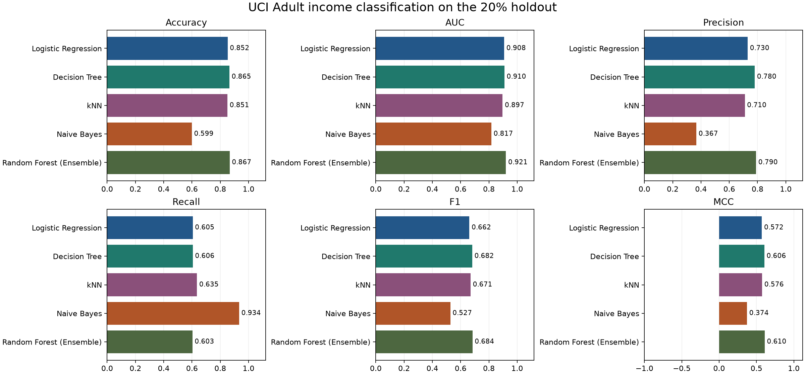

# Adult income classification

## Problem statement

Predict whether annual income exceeds $50,000 using features from the 1994 US Census. Compare five classifiers on the same held-out records using six evaluation metrics.

## Dataset description

The [UCI Adult dataset](https://archive.ics.uci.edu/dataset/2/adult), DOI [10.24432/C5XW20](https://doi.org/10.24432/C5XW20), contains 48,842 records and 14 predictors. It was selected because it combines numerical and categorical inputs, real missing values, and an imbalanced binary outcome. The local `data/` directory contains the two original UCI data files for offline reproduction. UCI lists the dataset under CC BY 4.0.

- **Target** — `income`, with `>50K` as the positive class and `<=50K` as the negative class.
- **Numeric predictors** — `age`, `fnlwgt` (census sample weight, used here as a predictor), `education_num`, `capital_gain`, `capital_loss`, and `hours_per_week`.
- **Categorical predictors** — `workclass`, `education`, `marital_status`, `occupation`, `relationship`, `race`, `sex`, and `native_country`.
- **Missing values before deduplication** — 2,799 in `workclass`, 2,809 in `occupation`, and 857 in `native_country`.

| Partition | Rows | At or below $50K | Above $50K | Positive share |
| --- | ---: | ---: | ---: | ---: |
| Original | 48,842 | 37,155 | 11,687 | 23.93% |
| Deduplicated | 48,790 | 37,109 | 11,681 | 23.94% |
| Training | 39,032 | 29,687 | 9,345 | 23.94% |
| Holdout | 9,758 | 7,422 | 2,336 | 23.94% |

The majority class is about 3.2 times as common as the positive class. An always-majority classifier would score 76.06% holdout accuracy with zero positive-class recall. The experiment retains the original class distribution without resampling and uses MCC as the primary comparison metric because it accounts for all four confusion-matrix counts.

### Preprocessing

1. Combine the two source partitions, normalize the income label suffix, treat question marks as missing, and remove 52 exact duplicate records before splitting.
2. Create a stratified 80:20 split with seed 42. Export the raw holdout, including its labels, as `test_data.csv`.
3. Fit each preprocessing pipeline on training rows. Impute numeric columns with training medians and categorical columns with training modes. One-hot encode categorical columns and ignore categories first encountered at inference.
4. Standardize numeric inputs for logistic regression, kNN, and Gaussian Naive Bayes. The tree models use unscaled numeric inputs.

## GitHub Repository Link

Local project. A GitHub link can be added when the repository is published.

## Models used

| Model | Configuration |
| --- | --- |
| Logistic Regression | Default regularization, maximum 1,000 training iterations |
| Decision Tree | Maximum depth 10, minimum 10 samples per leaf, seed 42 |
| kNN | 15 neighbors, uniform weights, Euclidean distance |
| Naive Bayes | Gaussian likelihood, default variance smoothing |
| Random Forest (Ensemble) | 120 trees, maximum depth 18, minimum 4 samples per leaf, seed 42 |

### Comparison table

AUC is ROC AUC computed from the predicted probability of `>50K`. Precision, recall, and F1 refer to that positive class. Hard labels use the class with the greater predicted probability, with ties assigned to the negative class.

| ML Model Name | Accuracy | AUC | Precision | Recall | F1 | MCC |
| --- | ---: | ---: | ---: | ---: | ---: | ---: |
| Logistic Regression | 0.8520 | 0.9081 | 0.7304 | 0.6053 | 0.6620 | 0.5724 |
| Decision Tree | 0.8648 | 0.9099 | 0.7805 | 0.6057 | 0.6821 | 0.6057 |
| kNN | 0.8506 | 0.8969 | 0.7100 | 0.6353 | 0.6706 | 0.5758 |
| Naive Bayes | 0.5990 | 0.8174 | 0.3672 | 0.9336 | 0.5271 | 0.3736 |
| Random Forest (Ensemble) | 0.8666 | 0.9206 | 0.7898 | 0.6032 | 0.6840 | 0.6101 |

### Metric visualization



### Observations

| ML Model Name | Observation about model performance |
| --- | --- |
| Logistic Regression | AUC reached 0.9081, close to the decision tree. Its lower precision yielded a lower F1 at the default decision threshold. |
| Decision Tree | Its precision, F1, and MCC were second highest. Its MCC of 0.6057 was within 0.0044 of the forest. |
| kNN | Recall was 0.6353, above both tree models, with lower precision and ROC AUC. |
| Naive Bayes | It found 93.36% of positive cases, while only 36.72% of its positive predictions were correct. Its accuracy fell below the majority baseline. |
| Random Forest (Ensemble) | It led in accuracy, AUC, precision, F1, and MCC. Recall was 0.6032, so it missed nearly 40% of positive cases at the default threshold. |

**Overall winner** — Random Forest on this holdout, with MCC 0.6101 and ROC AUC 0.9206. The comparison uses one split and reflects the configurations shown above.

## Local execution

The experiment was run with Python 3.14.6. From the project root, run the following with Python 3.14 and compatible wheels for your platform.

```sh
python -m pip install -r requirements.txt
python train.py
```

The run works offline once dependencies are installed. It produces the following files.

- `test_data.csv` contains the 9,758 held-out rows.
- `model/*.joblib` contains the five fitted preprocessing and classifier pipelines. Model definitions are in `model/classifiers.py`.
- `results/metrics.csv` contains the six scores per classifier.
- `results/metrics.png` contains the metric chart.
- `results/dataset_summary.json` contains missing-value, duplicate, and class counts.
